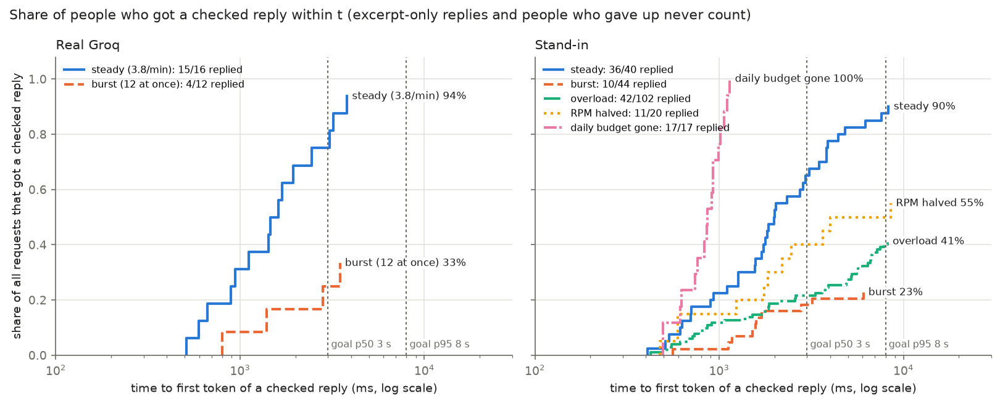

# The Relay: write-up

## 1 What I built and why
Python/asyncio on Groq's free tier: **route** (20b) → **retrieve** (BM25; chunks keep paper, section, page) → **decide** (refuse or re-retrieve once) → **draft** (120b, every sentence cited) → **check** (every number must appear in a cited passage) → **verify** (20b, one revise loop). A client-side governor models each per-model limit and corrects itself from rate-limit headers and 429 bodies.

**"Fast"** means the first *verified* token within 3 s (p50) and 8 s (p95); after that, a weaker but honest reply.

**The decision that shaped it:** answers are held until they pass the checks, then sent. Nothing unchecked is shown and then taken back. In the slowest real request (A04, §4) holding cost **1,090 ms**, almost all of it the 1,004 ms verifier; without the verifier it costs tens of milliseconds.

Every request runs on a ladder: **L0** full pipeline; **L1** no verifier; **L2** 20b drafts from fewer passages, labelled; **L3** cited excerpts only. I give up quality to stay available, never correctness.

## 2 The real service and my stand-in
I measured the limits with 79 real probe requests (Table 1; `probe` rows in results.csv):
- **Requests per minute are loosely enforced.** 34 of 35 simultaneous requests were accepted; the one refused was the last to arrive (241 ms after the rest), so Groq let about 4 past "Limit 30" before refusing, perhaps because servers count separately.
- **Recovery** after a 429: 2.5 s (RPM), 3.5 s (TPM).
- **The daily token budget refills continuously.** Two real per-day 429s (1,082 tokens short → "try again in 7m47s"; 871 → "6m16s") both give 2.32 tokens/s = 200,000/86,400. That is Groq's own formula; I did not confirm it by waiting.

The binding limit is **tokens**: 8,000 per minute ÷ ~2,150 tokens per answer ≈ **3.7 answers per minute** (1.86 if halved).

The **stand-in** speaks Groq's protocol (SSE, Groq-shaped 429s and headers, per-model windows) and can be slow, fail, stall, succeed slowly, rate-limit and slow down under load. Fitted to the probe, its first-token medians are within 7–30 % of real but its **total** times are 27–60 % higher, so its latencies are pessimistic. **Where it differs most:** a strict 60 s token window where Groq refills continuously (harsher on bursts), an invented load slowdown, and independent failures where real ones cluster.

## 3 Results
Real runs: probe, real_steady, real_burst, real_daily_exhausted and the quality runs; the rest are stand-in. Percentiles use linear interpolation; n is in each table.

**A number I couldn't have guessed:** in the first quality run, 9 of 26 questions spent 53–58 s waiting for per-minute budget and the other 17 took 0.5–4.5 s, with nothing in between: about one request in three hit the 8,000-token wall.

**Quality** on 26 questions (19 answerable, 7 not), chosen configuration: **15/19 correct and cited**, **7/7 unanswerable correctly refused**, 2 wrong, 2 wrongly refused, **1,912 tokens per answer**. A grader bug (it rejected "100 K" and "37 000") was fixed and every saved answer regraded; `scripts/regrade.py` prints each change.

*Share of all requests that got a checked reply within t. Curves end below 100 % because the rest got excerpts or gave up.*

## 4 Where the time goes
The slowest real request (eval_main A04, "How long did the big Transformer take to train…") took **57,743 ms**: **55,503 ms waiting (96 %)**, **2,239 ms working**, **0 ms retrying**. The work: route 485 ms, retrieve 6 ms, draft 745 ms (first answer token after 659 ms), check 0 ms, verify 1,004 ms.

The three questions before it had used ~8,100 tokens in under 5 s, so the governor held the draft until the minute budget refilled rather than take a 429. All of it came before the first token (held until checked; streaming would have shown one at 56,653 ms). I know the split because each step is timed on one clock per request (`traces.jsonl`) and the governor records its own wait.

## 5 When a limit is hit
**Per minute.** If the predicted wait fits the 8 s deadline, the request queues FIFO, delaying later arrivals. Otherwise it drops a level: first the verifier goes (the deterministic checks still catch invented numbers), then the 120b drafter (the reply carries a notice), then generation stops and the person gets excerpts at once. So whoever arrives while the minute's budget is spent gets the weaker reply: in the real 12-request burst, 4 got answers and 8 got excerpts. Nobody is dropped silently. If someone gives up, their remaining calls are cancelled; tokens already spent are lost (226–3,535 per stand-in scenario).

**Per day.** When 120b reaches a 3 % reserve, everyone gets 20b answers: on the stand-in with 120b's day gone, all 17 people did (first token p50 861 ms). When 20b's budget is gone too, everyone gets excerpts; on Groq, in real_daily_exhausted, all 26 got excerpts in a median of **2 ms**, with no wrong answers.

## Retrieval: quality versus cost
Same 20b pipeline, three settings (each question is worth 3.8 points, so the gaps are small):

| Setting | Correct | Wrong | Tokens per answer |
|---|---|---|---|
| **small 120w × 8** | **61.5 %** | 11.5 % | 1,893 |
| medium 250w × 4 + re-rank | 57.7 % | 11.5 % | 1,828 |
| large 600w × 3 | 53.8 % | 7.7 % | 2,186 |

I chose **small**: most correct for about medium's tokens, and the best offline recall (89.5 % vs 84.2 %). Re-ranking added nothing. Large cost 15–20 % more tokens and refused most, although it found the right page as often as medium (84.2 %): with 600-word passages the model picked out the answer less often. Plain medium was dropped (5 of 26 questions ran out of budget). Near the limit, retrieval drops to 120w × 4 (half the prompt; quality untested).

## How this library will mislead a naive retriever
1. **Bibliographies.** For "What is SoundStream?", naive BM25 put 2 reference-list chunks (Moshi pp. 51–52) in its top 4. Across 14 such questions, naive retrieval was polluted for 2, ours for 0, because we drop reference lists.
2. **Shared vocabulary.** "What BLEU does H-Net get on WMT14?" retrieves the Transformer's §6.1, the only place those words occur. Retrieval can't fix that; the refusal rule does (U01 was refused).
3. **Similar experiments in one paper.** H-Net trains on FineWeb-Edu (§3.1) and on a Chinese/code mix (§3.2); A16 answered from the wrong one, a real sentence from the cited page.

Also: the Transformer's own "[31, 2]" citations look like our passage labels (stripped now), and v7 reports 41.8 BLEU in the abstract but 41.0 in §6.1.

## 6 Retries
**Policy:** on a 429, honour `retry-after` once if it fits the deadline; on a 5xx, one jittered retry; if 120b sends nothing within 4 s, fall back to 20b; never retry a daily limit or after tokens were sent.

**What I could and couldn't show:** Against naive retrying (same model, up to 3×, ignoring `retry-after`), three stand-in runs each picked a different winner: only ~4 of 23 requests were ever retried, and the two versions drew different patience per user. In bursts the governor sends most arrivals to excerpts before any model call, so there were no 429s to retry. **Where retrying did hurt:** in one run naive retrying spent 3,535 tokens on people who had already left (vs 0), about two answers of daily budget; on Groq, real_burst A02 retried twice and still got excerpts after 5.4 s.

## 7 What the person sees
At 3 pm, if only 120b's day is gone, the person gets a cited 20b answer ending: *"Answered by our smaller model because the main model is at its usage limit… checked against the cited passages, but may be less complete."* If both are gone, within ~2 ms they get, word for word from real_daily_exhausted: *"I can't write a full answer right now: the assistant has used its model budget. Ask again in about 5 seconds for a full answer. In the meantime, these passages from the papers look most relevant: [1] "…" (paper, §, page)."* The **"5 seconds" is wrong**: it came from the per-minute estimate, while the daily budget refills at 2.32 tokens/s, so a full answer needs about 15 minutes. The fix: take the wait from the daily 429's retry-after.

## 8 What I'm unsure about, what I left out, what I learned
**Least certain assumption:** that Groq charges `max_completion_tokens` against the minute budget at admission; if it charges only tokens used, my governor degrades too early.

**Known weaknesses:** stand-in "steady" ran at ~140 % of token capacity (5.2 vs ~3.7/min); "rpm_halved" halved requests, not the token limit that binds; my retry comparison was invalid because patience wasn't paired between runs. Stand-in runs were re-run after two late fixes; the real runs predate them.

**Not built:** an answer cache (it hides limit behaviour; a cached wrong answer reaches everyone) and embeddings (another rate-limited dependency; BM25 is free and ~3 ms).

**New to me:** how documents are cut matters more than I expected. With the model fixed, 120-word pieces got 61.5 % correct and 600-word pieces 53.8 %. And Groq's daily limit is a slowly refilling bucket, not a midnight reset, so the honest message is "try again in a few minutes", not "come back tomorrow".

## Your feedback on Vaani
**What stood out:** the Teacher AI feature: creating and customising voice agents in plain language instead of configuring everything by hand. The multilingual support and realistic conversations make the platform interesting.
**What confused me:** at first it wasn't clear how creating, configuring, testing and deploying an agent differ.
**What I would change:** a guided onboarding where a new user builds a first voice agent, tests a real conversation and integrates it step by step, with no technical background needed.

## How I worked with the assistant
Both full, unedited chats are attached.

**Three prompts that mattered:** (1) pasting the whole brief and asking for every requirement, which set the scope: a measured system, not a demo; (2) "Is our project really solving the problem they asked?", which found a ~5-page write-up and probe rows missing from results.csv; (3) "Make more better" after 14/19, which led to 15/19 with 26 % fewer tokens.

**What it got wrong that I caught:** it built on Llama models Groq had retired (my probe returned `404 model_not_found`); its first quality sweep lost 9 of 26 answers by sending faster than 8K tokens/min allows. A second assistant reviewing my outputs caught the ~55 s budget waits, a regrade undoing my grader fix, fake "[36]" citations and the unpaired retry runs.

**Where I overruled it:** it planned the real runs over two days; I finished Thursday, re-planning around the daily refill.

**Not mine:** the code and the 26 questions were drafted by the assistant. **Mine:** every real run on my account and machine; pushing past the first result; recovering deleted results from the Recycle Bin.

---
## Results tables

**Table 1: Limits found in the real service** (real, from `raw/probe_real.jsonl`)

| Limit | Value found | How found | Confidence |
|---|---|---|---|
| Requests per minute | 429 says "Limit 30", but 34 of 35 simultaneous requests were accepted; the refused one arrived last (241 ms after the rest) | 35 tiny requests at once after 65 s of quiet | medium |
| Tokens per minute | 8,000 (both models); 429 after 8 back-to-back ~1K-token calls | header, then calls until 429 | high |
| Requests per day | 1,000 (both models) | `x-ratelimit-limit-requests` header | medium |
| Tokens per day | 200,000; hit on 20b | two real per-day 429s | high |
| Requests in flight | no separate limit up to 35 | same burst; refusals were all RPM | medium |
| On a limit | HTTP 429, `type=requests/tokens`, `rate_limit_exceeded`, `retry-after: 2` | first 429 | high |
| Recovery | RPM 2.5 s; TPM 3.5 s; per-day refills at 2.32 tokens/s | polling; per-day rate from two 429s (not confirmed by waiting) | high (minute) / medium (day) |

**Table 2a: Latency**

| Scenario | Real or stand-in | Requests | Duration (s) | Offered rate (/min) | First token p50 / p95 / p99 (ms) | Total p50 / p95 / p99 (ms) |
|---|---|---|---|---|---|---|
| probe | real | 79 | 785 | 6.0 | 437 / 942 / 1500 | 552 / 824 / 1165 |
| real_steady | real | 16 | 255 | 3.8 | 1537 / 3355 / 3712 | 1537 / 3355 / 3712 |
| real_burst | real | 12 | 6 | 389.2 | 1161 / 4338 / 5179 | 1161 / 4339 / 5179 |
| real_daily_exhausted | real | 26 | <1 | back to back | 2 / 7 / 162 | 2 / 7 / 163 |
| steady | stand-in | 40 | 468 | 5.2 | 1801 / 6428 / 8050 | 1802 / 6428 / 8051 |
| burst | stand-in | 44 | 86 | 31.7 | 5 / 3147 / 5073 | 6 / 3147 / 5074 |
| sustained_overload | stand-in | 102 | 296 | 21.0 | 646 / 6728 / 7874 | 646 / 6728 / 7874 |
| rpm_halved | stand-in | 20 | 338 | 3.6 | 1799 / 6365 / 8107 | 1799 / 6365 / 8108 |
| daily_exhausted | stand-in | 17 | 206 | 5.0 | 861 / 1116 / 1137 | 861 / 1116 / 1137 |
| burst_naive_retry | stand-in | 44 | 87 | 31.7 | 5 / 1890 / 4949 | 5 / 1890 / 4949 |
| slow_provider | stand-in | 23 | 165 | 8.5 | 1025 / 6173 / 8438 | 1025 / 6173 / 8438 |
| slow_provider_naive_retry | stand-in | 23 | 170 | 8.5 | 1181 / 6390 / 7268 | 1181 / 6390 / 7268 |

**Table 2b: Outcomes**

| Scenario | Succeeded % | Rate-limited % | Timed out / given up % | Retries / request | Peak queue | Tokens / answer | Cost / 1,000 answers |
|---|---|---|---|---|---|---|---|
| probe | 91.1 | 8.9 | 0.0 | 0.00 | 35 | 426 | $0.05 |
| real_steady | 93.8 | 6.2 | 0.0 | 0.00 | 2 | 2152 | $0.34 |
| real_burst | 33.3 | 66.7 | 0.0 | 0.67 | 10 | 1963 | $0.31 |
| real_daily_exhausted | 0.0 | 100.0 | 0.0 | 0.00 | 2 | not measured | not measured |
| steady | 90.0 | 5.0 | 5.0 | 0.10 | 3 | 1829 | $0.24 |
| burst | 22.7 | 77.3 | 0.0 | 0.05 | 7 | 1470 | $0.20 |
| sustained_overload | 41.2 | 51.0 | 7.8 | 0.10 | 7 | 1379 | $0.18 |
| rpm_halved | 55.0 | 25.0 | 20.0 | 0.10 | 2 | 1563 | $0.21 |
| daily_exhausted | 100.0 | 0.0 | 0.0 | 0.00 | 2 | 913 | $0.08 |
| burst_naive_retry | 18.2 | 81.8 | 0.0 | 0.07 | 7 | 1787 | $0.24 |
| slow_provider | 65.2 | 30.4 | 4.3 | 0.17 | 3 | 1877 | $0.24 |
| slow_provider_naive_retry | 65.2 | 26.1 | 8.7 | 0.17 | 3 | 1523 | $0.22 |

**Table 3: Retrieval settings** (real; 26 questions each)

| Setting (piece size, pieces, re-rank) | Questions | Correct and cited % | Wrong % | Correctly refused % | Tokens / answer | First token p50 / p95 (ms) | Total p50 / p95 (ms) |
|---|---|---|---|---|---|---|---|
| small 120w / 8 / no (20b drafter) | 26 | 61.5 | 11.5 | 26.9 | 1893 | 1346 / 58567 | 1346 / 58568 |
| medium_rerank 250w / 4 / yes (20b drafter) | 26 | 57.7 | 11.5 | 26.9 | 1828 | 1027 / 58988 | 1027 / 58989 |
| large 600w / 3 / no (20b drafter) | 26 | 53.8 | 7.7 | 26.9 | 2186 | 11235 / 48910 | 11235 / 48910 |
| *different pipeline:* medium_rerank 250w / 4 / yes (120b + 20b router/verifier) | 26 | 53.8 | 3.8 | 26.9 | 2576 | 3050 / 57765 | 3050 / 57765 |
| *different pipeline:* **small 120w / 8 / no (120b, checks only): chosen** | 26 | 57.7 | 7.7 | 26.9 | 1912 | 1204 / 58439 | 1205 / 58440 |

**Notes.** The first three rows of Table 3 are the comparison (same pipeline); the last two used different pipelines. Quality runs ask one question at a time under 8K tokens/min, so their p95 latency includes up to ~58 s of budget waiting; Table 2 is the latency reference. The probe's total-time percentiles include fast 429s; its peak queue of 35 is the deliberate simultaneous burst. "Rate-limited" counts every excerpt reply; real_steady's one was a check failure under older code. Stand-in "steady" ran above capacity (5.2 vs ~3.7/min); "rpm_halved" halved requests per minute, not tokens. The API did not report hidden reasoning tokens. results.csv's first 12 columns are the brief's; the rest are extra detail. Offline recall (0 tokens): small 89.5 %, medium 84.2 %, medium + re-rank 84.2 %, large 84.2 %, small_lean 78.9 %, lean 68.4 %.