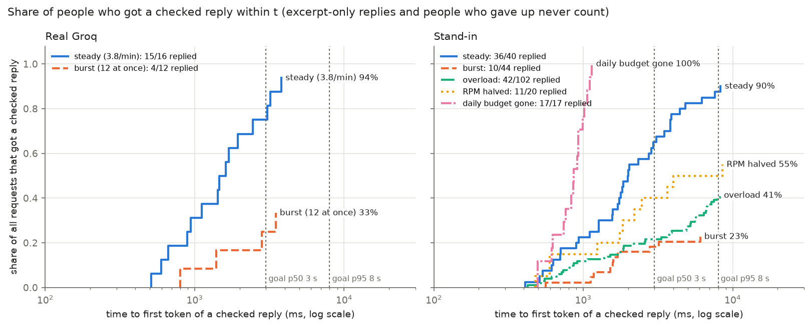

# Tables (generated by scripts/analyze.py from results/results.csv)

## Table 1: Limits found in the real service
| Limit | Value you found | How you found it | Confidence (high, medium, low) |
|---|---|---|---|
| Requests per minute | 34 of 35 simultaneous requests accepted on the small model; 429 says Limit 30 | 35 tiny requests fired at once after a 65 s quiet period; counted 200s vs 429s | high |
| Tokens per minute | 20b: 8000; 120b: 8000; 429 after 8 back-to-back ~1K-token calls, message says Limit 8000 | x-ratelimit-limit-tokens header on every response; then back-to-back ~1K-token prompts until 429 | high |
| Requests per day | 20b: 1000; 120b: 1000 | x-ratelimit-limit-requests header (remaining-requests falls by 1 per call) | medium |
| Tokens per day | from 429: Limit 200000 | hit during experiments (provider_events.jsonl) | high |
| Requests in flight at once | no separate limit seen: all 35 simultaneous requests were answered or refused by RPM only | same 35-request burst; refusals all carried the RPM message | medium |
| What it returns when a limit is hit | HTTP 429, JSON error type=requests, code=rate_limit_exceeded, retry-after: 2 s, message names the limit, used, requested | raw/probe_real.jsonl, first 429 | high |
| Time until it recovers | RPM: 2.5 s; TPM: 3.5 s | polled once per second with a 1-token request after the first 429 | medium |

Real latency (probe, sequential, under all limits):

| model | prompt | n | TTFT p50 / p95 / p99 (ms) | total p50 / p95 / p99 (ms) | visible tok/s p50 | hidden reasoning tokens p50 |
|---|---|---|---|---|---|---|
| openai/gpt-oss-20b | short | 7 | 446 / 1480 / 1641 | 463 / 1501 / 1669 | 1321 | 0 |
| openai/gpt-oss-20b | ~1K tokens | 7 | 490 / 745 / 792 | 536 / 809 / 851 | 1190 | 0 |
| openai/gpt-oss-120b | short | 7 | 371 / 719 / 794 | 505 / 817 / 916 | 652 | 0 |
| openai/gpt-oss-120b | ~1K tokens | 7 | 471 / 723 / 731 | 558 / 809 / 818 | 748 | 0 |

## Table 2a: Latency
| Scenario | Real or stand-in | Requests sent | Duration (s) | Offered rate (per min) | First token p50 / p95 / p99 (ms) | Total time p50 / p95 / p99 (ms) |
|---|---|---|---|---|---|---|
| probe | real | 79 | 785 | 6.0 | 437 / 942 / 1500 | 552 / 824 / 1165 |
| real_steady | real | 16 | 255 | 3.8 | 1537 / 3355 / 3712 | 1537 / 3355 / 3712 |
| real_burst | real | 12 | 6 | 389.2 | 1161 / 4338 / 5179 | 1161 / 4339 / 5179 |
| steady | stand-in | 40 | 468 | 5.2 | 1801 / 6428 / 8050 | 1802 / 6428 / 8051 |
| burst | stand-in | 44 | 86 | 31.7 | 5 / 3147 / 5073 | 6 / 3147 / 5074 |
| sustained_overload | stand-in | 102 | 296 | 21.0 | 646 / 6728 / 7874 | 646 / 6728 / 7874 |
| rpm_halved | stand-in | 20 | 338 | 3.6 | 1799 / 6365 / 8107 | 1799 / 6365 / 8108 |
| daily_exhausted | stand-in | 17 | 206 | 5.0 | 861 / 1116 / 1137 | 861 / 1116 / 1137 |
| burst_naive_retry | stand-in | 44 | 87 | 31.7 | 5 / 1890 / 4949 | 5 / 1890 / 4949 |
| slow_provider | stand-in | 23 | 165 | 8.5 | 1025 / 6173 / 8438 | 1025 / 6173 / 8438 |
| slow_provider_naive_retry | stand-in | 23 | 170 | 8.5 | 1181 / 6390 / 7268 | 1181 / 6390 / 7268 |
| real_daily_exhausted | real | 26 | 0 | 5401.7 | 2 / 7 / 162 | 2 / 7 / 163 |

## Table 2b: Outcomes
| Scenario | Succeeded % | Rate-limited % | Timed out or given up % | Retries per request | Peak queue length | Tokens per answer | Cost per 1,000 answers |
|---|---|---|---|---|---|---|---|
| probe | 91.1 | 8.9 | 0.0 | 0.00 | 35 | 426 | $0.05 |
| real_steady | 93.8 | 6.2 | 0.0 | 0.00 | 2 | 2152 | $0.34 |
| real_burst | 33.3 | 66.7 | 0.0 | 0.67 | 10 | 1963 | $0.31 |
| steady | 90.0 | 5.0 | 5.0 | 0.10 | 3 | 1829 | $0.24 |
| burst | 22.7 | 77.3 | 0.0 | 0.05 | 7 | 1470 | $0.20 |
| sustained_overload | 41.2 | 51.0 | 7.8 | 0.10 | 7 | 1379 | $0.18 |
| rpm_halved | 55.0 | 25.0 | 20.0 | 0.10 | 2 | 1563 | $0.21 |
| daily_exhausted | 100.0 | 0.0 | 0.0 | 0.00 | 2 | 913 | $0.08 |
| burst_naive_retry | 18.2 | 81.8 | 0.0 | 0.07 | 7 | 1787 | $0.24 |
| slow_provider | 65.2 | 30.4 | 4.3 | 0.17 | 3 | 1877 | $0.24 |
| slow_provider_naive_retry | 65.2 | 26.1 | 8.7 | 0.17 | 3 | 1523 | $0.22 |
| real_daily_exhausted | 0.0 | 100.0 | 0.0 | 0.00 | 2 | not measured | not measured |

### Extra: what kind of reply people got
| Scenario | Full answer (L0/L1) % | small-model answer (L2) % | Excerpts (L3) % | Error % | First token p50/p95, full answers only (ms) | Tokens wasted on given-up requests |
|---|---|---|---|---|---|---|
| probe | 0.0 | 0.0 | 8.9 | 0.0 | not measured | 0 |
| real_steady | 68.8 | 25.0 | 6.2 | 0.0 | 1697 / 3504 | 0 |
| real_burst | 25.0 | 8.3 | 66.7 | 0.0 | 2816 / 3413 | 0 |
| steady | 60.0 | 30.0 | 5.0 | 0.0 | 2539 / 7406 | 226 |
| burst | 11.4 | 11.4 | 77.3 | 0.0 | 2796 / 5488 | 0 |
| sustained_overload | 21.6 | 19.6 | 51.0 | 0.0 | 3724 / 6699 | 222 |
| rpm_halved | 30.0 | 25.0 | 25.0 | 0.0 | 2336 / 3915 | 0 |
| daily_exhausted | 0.0 | 100.0 | 0.0 | 0.0 | not measured | 0 |
| burst_naive_retry | 13.6 | 4.5 | 81.8 | 0.0 | 1773 / 5360 | 0 |
| slow_provider | 39.1 | 26.1 | 30.4 | 0.0 | 3659 / 7903 | 0 |
| slow_provider_naive_retry | 26.1 | 39.1 | 26.1 | 0.0 | 2010 / 5391 | 3535 |
| real_daily_exhausted | 0.0 | 0.0 | 100.0 | 0.0 | not measured | 0 |

## Table 3: Retrieval settings
| Setting (piece size, pieces fetched, re-rank yes or no) | Questions asked | Correct and cited % | Wrong % | Correctly refused % | Tokens per answer | First token p50 / p95 (ms) | Total time p50 / p95 (ms) |
|---|---|---|---|---|---|---|---|
| large:600w/k3/norerank (20b drafter) | 26 | 53.8 | 7.7 | 26.9 | 2186 | 11235 / 48910 | 11235 / 48910 |
| medium_rerank:250w/k4/rerank16->4 (20b drafter) | 26 | 57.7 | 11.5 | 26.9 | 1828 | 1027 / 58988 | 1027 / 58989 |
| small:120w/k8/norerank (20b drafter) | 26 | 61.5 | 11.5 | 26.9 | 1893 | 1346 / 58567 | 1346 / 58568 |
| medium_rerank:250w/k4/rerank16->4 (120b drafter + 20b router/verifier) | 26 | 53.8 | 3.8 | 26.9 | 2576 | 3050 / 57765 | 3050 / 57765 |
| small:120w/k8/norerank (120b drafter, checks only) | 26 | 57.7 | 7.7 | 26.9 | 1912 | 1204 / 58439 | 1205 / 58440 |

## Answer quality (eval_main)
26 questions (19 answerable, 7 not answerable from the papers). Grades: {'correct': 14, 'refused_wrongly': 4, 'wrong': 1, 'refused_correctly': 7}.
Answerable correct and cited: 14/19; unanswerable correctly refused: 7/7; refused when it should have answered: 4.
Tokens per answer: median 2216, mean 2576, max 4908.

| q | grade | level | drafter | tokens | first token ms |
|---|---|---|---|---|---|
| A01 | correct | L0 | 120b | 2144 | 1613.3 |
| A02 | correct | L0 | 120b | 3106 | 1300.6 |
| A03 | correct | L0 | 120b | 2895 | 1838.6 |
| A04 | correct | L0 | 120b | 2926 | 57742.7 |
| A05 | correct | L0 | 120b | 3220 | 1588.8 |
| A06 | correct | L0 | 120b | 3076 | 1580.2 |
| A07 | refused_wrongly | L3 | 120b | 4046 | 57772.1 |
| A08 | correct | L0 | 120b | 2068 | 2918.9 |
| A09 | correct | L0 | 120b | 3351 | 55310.0 |
| A10 | refused_wrongly | L0 | 120b | 2088 | 1747.5 |
| A11 | wrong | L0 | 120b | 2827 | 3180.5 |
| A12 | correct | L0 | 120b | 4908 | 57641.6 |
| A13 | correct | L0 | 120b | 2869 | 4531.4 |
| A14 | correct | L0 | 120b | 1966 | 53156.6 |
| A15 | correct | L0 | 120b | 2199 | 2868.6 |
| A16 | refused_wrongly | L0 | 120b | 2121 | 2381.8 |
| A17 | refused_wrongly | L3 | 120b | 6399 | 57888.6 |
| A18 | correct | L0 | 120b | 2476 | 2574.3 |
| A19 | correct | L0 | 120b | 3105 | 54494.8 |
| U01 | refused_correctly | L0 | 120b | 1794 | 2214.7 |
| U02 | refused_correctly | L0 | 120b | 2192 | 3460.4 |
| U03 | refused_correctly | L0 | 120b | 1998 | 1903.4 |
| U04 | refused_correctly | L0 | 120b | 2015 | 54740.4 |
| U05 | refused_correctly | L0 | 120b | 2232 | 3346.4 |
| U06 | refused_correctly | L0 | 120b | 2117 | 2034.4 |
| U07 | refused_correctly | L0 | 120b | 2120 | 54667.7 |

## Answer quality (eval_final: small retrieval + 120b)
26 questions (19 answerable, 7 not answerable from the papers). Grades: {'correct': 15, 'refused_wrongly': 2, 'wrong': 2, 'refused_correctly': 7}.
Answerable correct and cited: 15/19; unanswerable correctly refused: 7/7; refused when it should have answered: 2.
Tokens per answer: median 1914, mean 1912, max 2197.

| q | grade | level | drafter | tokens | first token ms |
|---|---|---|---|---|---|
| A01 | correct | L1 | 120b | 1835 | 1286.1 |
| A02 | correct | L1 | 120b | 2139 | 544.7 |
| A03 | correct | L1 | 120b | 1892 | 680.0 |
| A04 | correct | L1 | 120b | 2144 | 58296.5 |
| A05 | refused_wrongly | L3 | 120b | 3948 | 2375.5 |
| A06 | correct | L1 | 120b | 1787 | 57753.0 |
| A07 | correct | L1 | 120b | 1963 | 1079.3 |
| A08 | correct | L1 | 120b | 1918 | 918.6 |
| A09 | correct | L1 | 120b | 2197 | 58422.0 |
| A10 | correct | L1 | 120b | 1853 | 899.0 |
| A11 | wrong | L1 | 120b | 1923 | 725.2 |
| A12 | correct | L1 | 120b | 1958 | 58445.2 |
| A13 | correct | L1 | 120b | 1979 | 648.7 |
| A14 | correct | L1 | 120b | 1738 | 1122.6 |
| A15 | refused_wrongly | L3 | 120b | 3571 | 58642.2 |
| A16 | wrong | L1 | 120b | 2100 | 1487.5 |
| A17 | correct | L1 | 120b | 2037 | 57791.2 |
| A18 | correct | L1 | 120b | 1720 | 817.3 |
| A19 | correct | L1 | 120b | 1916 | 1474.4 |
| U01 | refused_correctly | L1 | 120b | 1911 | 57548.6 |
| U02 | refused_correctly | L1 | 120b | 1727 | 1096.8 |
| U03 | refused_correctly | L1 | 120b | 1856 | 1089.6 |
| U04 | refused_correctly | L1 | 120b | 1900 | 57775.0 |
| U05 | refused_correctly | L1 | 120b | 1727 | 1106.4 |
| U06 | refused_correctly | L1 | 120b | 1930 | 1073.3 |
| U07 | refused_correctly | L1 | 120b | 1747 | 57693.8 |

## Where the time goes (slowest successful request)
Request 571aac07c0 (real_steady, real, level L0, question A16): first token 3801 ms, total 3802 ms, retries 0.

| span | kind | start ms | end ms | duration ms | detail |
|---|---|---|---|---|---|
| queue | wait | 0 | 0 | 0 | {} |
| route | work | 0 | 1149 | 1149 | {"model": "openai/gpt-oss-20b", "provider_ttft_ms": 1111.7044999846257, "first_reasoning_ms": 1093.8510000123642, "token |
| retrieve | work | 1149 | 1156 | 7 | {"coverage": 0.78} |
| draft | work | 1156 | 3801 | 2644 | {"model": "openai/gpt-oss-120b", "provider_ttft_ms": 2586.2691000220366, "first_reasoning_ms": 2418.2491000392474, "toke |
| check | work | 3801 | 3801 | 0 | {"ok": true} |
| send | work | 3801 | 3802 | 1 | {} |

waiting 0 ms, working 3801 ms, retrying 0 ms, unaccounted 0 ms. Time before first token: 3801 ms (100% of total); spans fully before it: 3801 ms.
notes: ['router: in_scope=True paper=hnet']

## Offline retrieval (0 tokens)
| setting | recall@k (answerable, n) | passage tokens / question | retrieve ms |
|---|---|---|---|
| small:120w/k8/norerank | 89.5% (19) | 1432 | 6.36 |
| small_lean:120w/k4/norerank | 78.9% (19) | 715 | 1.68 |
| medium:250w/k4/norerank | 84.2% (19) | 1326 | 6.87 |
| medium_rerank:250w/k4/rerank16->4 | 84.2% (19) | 1384 | 4.7 |
| large:600w/k3/norerank | 84.2% (19) | 1836 | 6.35 |
| lean:250w/k2/rerank16->2 | 68.4% (19) | 660 | 4.4 |
| naive:250w/k4/norerank | 84.2% (19) | 1329 | 10.33 |

## How this library misleads a naive retriever
Reference-list pollution: for 14 questions about other work, a references chunk was in the top-4 for 2 with the naive retriever and 0 with ours (references dropped from the index). Worst case: 'What is SoundStream?' (2 of 4 hits were bibliography).
naive top-3 for the worst case:
   - moshi     §3.3.1 Architecture                      p.9   ref=0 | '3.3.1 Architecture Our baseline architecture takes inspiration from SoundStream (Zeghidour'
   - moshi     References                               p.52  ref=1 | 'Lili Yu, D ́ aniel Simig, Colin Flaherty, Armen Aghajanyan, Luke Zettlemoyer, and Mike Lew'
   - moshi     References                               p.51  ref=1 | 'Li, Lei He, Sheng Zhao, and Furu Wei. Neural codec language models are zero-shot text to s'
ours:
   - moshi     §3.3.1 Architecture                      p.9   ref=0 | '3.3.1 Architecture Our baseline architecture takes inspiration from SoundStream (Zeghidour'

### cross-paper vocabulary
Q: What BLEU score does H-Net get on WMT 2014 English-German translation?
Why: H-Net has no translation results; 'BLEU' and 'WMT' only occur in the Transformer paper, so lexical search returns the Transformer's numbers and a model happily attributes them to H-Net.
naive (BM25, references kept):
   - attention §6.1 Machine Translation                 p.8   ref=0 | '6.1 Machine Translation On the WMT 2014 English-to-German translation task, the big transf'
   - attention Abstract                                 p.1   ref=0 | 'Abstract The dominant sequence transduction models are based on complex recurrent or convo'
   - attention §7 Conclusion                            p.10  ref=0 | '7 Conclusion In this work, we presented the Transformer, the first sequence transduction m'
ours (references dropped, re-ranked):
   - attention §6.1 Machine Translation                 p.8   ref=0 | '6.1 Machine Translation On the WMT 2014 English-to-German translation task, the big transf'
   - attention Abstract                                 p.1   ref=0 | 'Abstract The dominant sequence transduction models are based on complex recurrent or convo'
   - attention §7 Conclusion                            p.10  ref=0 | '7 Conclusion In this work, we presented the Transformer, the first sequence transduction m'

### the paper disagrees with itself
Q: What BLEU score does the big Transformer get on WMT 2014 English-to-French?
Why: v7 says 41.8 in the abstract and Table 2 but 41.0 in Section 6.1; whichever chunk wins decides the answer.
naive (BM25, references kept):
   - attention §6.1 Machine Translation                 p.8   ref=0 | '6.1 Machine Translation On the WMT 2014 English-to-German translation task, the big transf'
   - attention Abstract                                 p.1   ref=0 | 'Abstract The dominant sequence transduction models are based on complex recurrent or convo'
   - attention §5.4 Regularization                      p.7   ref=0 | '5.4 Regularization We employ three types of regularization during training: 7 Table 2: The'
ours (references dropped, re-ranked):
   - attention §6.1 Machine Translation                 p.8   ref=0 | '6.1 Machine Translation On the WMT 2014 English-to-German translation task, the big transf'
   - attention Abstract                                 p.1   ref=0 | 'Abstract The dominant sequence transduction models are based on complex recurrent or convo'
   - attention §5.4 Regularization                      p.7   ref=0 | '5.4 Regularization We employ three types of regularization during training: 7 Table 2: The'

### tables lose their structure in PDF text
Q: What is the maximum path length for a restricted self-attention layer?
Why: Table 1 comes out of the PDF as a run of symbols; the right row is retrieved but its columns are scrambled.
naive (BM25, references kept):
   - attention §3.4 Embeddings and Softmax              p.5   ref=0 | '3.4 Embeddings and Softmax Similarly to other sequence transduction models, we use learned'
   - attention §4 Why Self-Attention                    p.6   ref=0 | 'layer connects all positions with a constant number of sequentially executed operations, w'
   - attention §4 Why Self-Attention                    p.6   ref=0 | '4 Why Self-Attention In this section we compare various aspects of self-attention layers t'
ours (references dropped, re-ranked):
   - attention §3.4 Embeddings and Softmax              p.5   ref=0 | '3.4 Embeddings and Softmax Similarly to other sequence transduction models, we use learned'
   - attention §4 Why Self-Attention                    p.6   ref=0 | 'layer connects all positions with a constant number of sequentially executed operations, w'
   - attention §4 Why Self-Attention                    p.6   ref=0 | '4 Why Self-Attention In this section we compare various aspects of self-attention layers t'

## Calibration check: real vs stand-in
| model | prompt | n | real TTFT p50/p90 (ms) | stand-in TTFT p50/p90 (ms) | real total p50/p90 | stand-in total p50/p90 |
|---|---|---|---|---|---|---|
| openai/gpt-oss-120b | short | 7 | 371 / 624 | 405 / 574 | 505 / 693 | 639 / 797 |
| openai/gpt-oss-120b | ~1K tok | 7 | 471 / 712 | 555 / 776 | 558 / 798 | 780 / 1002 |
| openai/gpt-oss-20b | short | 7 | 446 / 1279 | 479 / 1360 | 463 / 1291 | 688 / 1583 |
| openai/gpt-oss-20b | ~1K tok | 7 | 490 / 686 | 637 / 1013 | 536 / 757 | 856 / 1235 |
